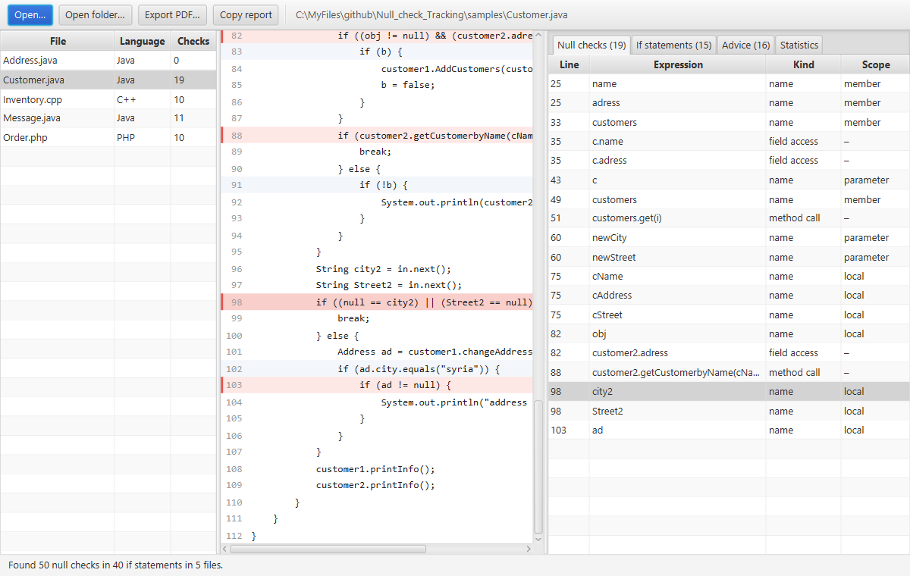

<h1 align="center">Tracking Null Checks in Java, PHP and C++ Systems</h1>

A tool that finds the `null` checks in Java, PHP and C/C++ code and explains them: which expressions are
compared with `null`, whether each one is a member, parameter, local, field access or method call, and where its
value was assigned before the check. It analyses a single file or a whole folder. It started as our 5th-year
project for the Software Engineering 3 course.

It comes with a JavaFX desktop app and a command-line tool, and it can save the report as a PDF.



## Features

- **Real parsing.** Source is parsed with [tree-sitter](https://tree-sitter.github.io/), so comments, strings,
  nesting and line breaks are handled exactly, and code that does not compile is analysed as far as it parses.
- **Finds every null check** in `if` conditions, inside `&&` / `||` chains, nested parentheses and negations:
  - **Java** (`.java`): `x == null`, `null != x`, `Objects.isNull(x)`, `Objects.nonNull(x)`.
  - **PHP** (`.php`, `.phtml`): `==`, `===`, `!=`, `!==` and `<>` with `null` in any case, `is_null(...)`,
    `isset(...)`, `elseif` and `and` / `or` / `xor`. Inline HTML and heredocs are skipped.
  - **C++** (`.cpp`, `.cc`, `.cxx`, `.h`, `.hpp`, …) and **C** (`.c`, parsed with the C grammar):
    `== nullptr`, `!= NULL`, and implicit pointer checks such as `if (p)`, `if (!p)` and
    `if (Node* n = next())` for raw pointers, `unique_ptr` and `shared_ptr`.
  - Java also accepts statically imported `isNull(x)` / `nonNull(x)`.
- **Classifies each comparand** as a method call, field access or name, and resolves names through the syntax
  tree to a **parameter** (of methods, constructors, lambdas, closures), **local variable** (including loop,
  catch, resource and pattern variables) or **member** of the enclosing class, including anonymous classes and
  out-of-line C++ member functions.
- **Traces definitions.** Lists the declarations and assignments of the same variable (not just the same name)
  that come before its first check, with advice such as "null assigned to name in line 13; assign another
  value instead of null". PHP property declarations, promoted constructor properties and parameter defaults
  count too.
- **Whole folders.** Analyses every supported file under a folder, with a summary per file and project-wide
  statistics. Hidden folders and `node_modules` are skipped; `build`, `target`, `out` and `dist` are skipped
  when a build file (`build.gradle.kts`, `pom.xml`, `package.json`, `CMakeLists.txt`, …) sits next to them, and
  `vendor` next to `composer.json` or `go.mod`, so source packages with those names are still analysed. A file
  that fails is listed in the report instead of stopping the run.
- **Statistics**: the share of `if` statements that check for null, and of comparands by kind and scope.
- **Desktop app**: open a file or a folder, browse the files, source listing with null checks highlighted,
  tables of checks, `if` statements and advice (click a row to jump to the line), charts for the file and the
  whole folder, drag-and-drop, export to PDF and copy as text.
- **Command line**: prints the report for a file or folder and can write a PDF, so it works in scripts and CI.

## Requirements

- JDK 21 or newer. Gradle downloads JavaFX, tree-sitter (with its native libraries for Windows x64, Linux
  x64/arm64 and macOS x64/arm64), iText and everything else, and the Gradle wrapper is included.

## Build & run

```bash
./gradlew :desktop:run                      # start the desktop app (the open dialogs start in samples/)
./gradlew :cli:run --args="samples/Customer.java"                        # print a report
./gradlew :cli:run --args="samples/Customer.java build/Customer.pdf"     # also write a PDF
./gradlew :cli:run --args="samples/Order.php"                            # a PHP file
./gradlew :cli:run --args="samples/Inventory.cpp"                        # a C++ file
./gradlew :cli:run --args="samples build/samples.pdf"                    # a whole folder
./gradlew build                             # compile and run all tests
./gradlew installDist                       # ready-to-run apps in */build/install/
```

On Windows use `gradlew.bat`. The desktop app also accepts a file or folder to open:
`./gradlew :desktop:run --args="Customer.java"` or `--args="."` for the whole samples folder.

`./gradlew javadoc` builds the API docs and fails if a public class or method is undocumented.

The language is chosen from the file extension; other extensions are analysed as Java. Names are resolved
within one file: the tool does not follow inheritance or includes, so a Java or C++ name without a visible
declaration (an inherited field, a static import, a global from a header) is reported as a member.

### Continuous integration

[`.github/workflows/build.yml`](.github/workflows/build.yml) runs on every pull request, on pushes to `master`
and on `v*` tags. It builds, tests and checks the docs on Linux, Windows and macOS, and uploads these workflow
artifacts:

| Artifact | Contents |
|---|---|
| `null-check-tracking-linux` / `-windows` / `-macos` | Desktop app zip for that OS (JavaFX includes native libraries). Run `bin/null-check-tracking`. |
| `null-check-cli` | Command-line zip for any OS. Run `bin/null-check`. |
| `sample-reports` | PDF reports for each file in `samples/`, and one for the whole folder. |

A JDK or JRE 21+ must be installed to run the zips.

## Project structure

```
Null_check_Tracking/
├── core/                        UI-independent library: com.aliibrahim.nullcheck.core
│   ├── NullCheckAnalyzer        finds if statements, null comparands, scopes and definitions
│   ├── ProjectAnalyzer          analyses every supported file in a folder (ProjectAnalysis, FileAnalysis)
│   ├── AnalysisResult, IfStatement, NullComparand, Definition, ComparandKind, NameScope
│   ├── Reports                  plain-text and PDF (iText) reports
│   ├── Language                 Java, PHP or C++, chosen from the file extension
│   ├── SyntaxTree               tree-sitter parsing and offset/line bookkeeping (internal)
│   └── LanguageRules            per-language rules: JavaRules, PhpRules, CppRules (internal)
├── cli/                         command-line tool: com.aliibrahim.nullcheck.cli.Main
├── desktop/                     JavaFX app: com.aliibrahim.nullcheck.desktop
│   ├── Launcher, NullCheckApp   start-up
│   ├── MainView, SourceView     window content
│   └── resources/…/app.css
├── samples/                     null-heavy example inputs (Customer, Message, Address, Order.php, Inventory.cpp)
├── docs/screenshot.png
└── gradle/libs.versions.toml    all dependency versions in one place
```

`core` has no UI dependencies, so both front ends and the tests share the same analysis and report code.

## License

The source code in this repository is licensed under the [MIT License](LICENSE).

PDF reports are written with [iText 5](https://github.com/itext/itextpdf), which is licensed under the AGPL.
The distributions (the zips that bundle the iText jar) are therefore subject to the AGPL's terms as a whole.
To make them MIT-only as well, replace iText with a permissively licensed PDF library such as OpenPDF or
Apache PDFBox.

## Authors

Ali Ibrahim and the Software Engineering 3 project group.
